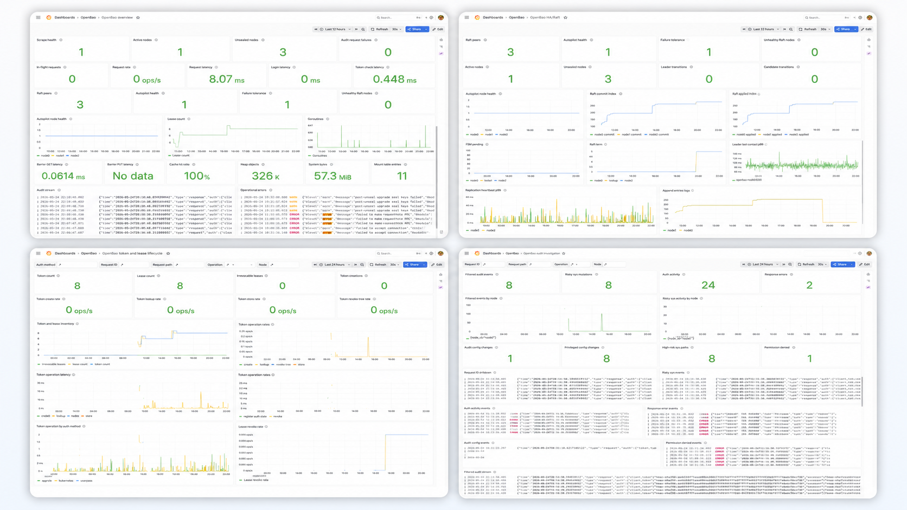

# OpenBao observability reference architecture

[](https://github.com/dc-tec/openbao-observability/actions/workflows/ci.yml)

Use this repository to design, test, and adapt OpenBao observability across
metrics, operational logs, audit logs, dashboards, alerts, and runbooks.

Source contracts define OpenBao signals, dashboards, and alerts. Generated
artifacts implement these contracts for Prometheus, Loki, Grafana, and Grafana
Alloy. The Splunk implementation profile provides Dashboard Studio dashboards
and a focused set of native alerts from the same contracts.

Adapt retention, access control, alert routing, capacity, and audit archive
controls to your deployment. The implementation profiles document their tested
behavior and remaining qualification work.



*Generated Grafana dashboards from the local OpenBao observability profile.*

## What you get

- Source contracts for OpenBao metrics, log streams, alerts, and dashboards.
- Generated Prometheus, Loki, and Grafana artifacts.
- Splunk Dashboard Studio dashboards and native alerts with SPL searches.
- Grafana Alloy examples for operational logs, audit logs, and collection
  pipelines.
- Runnable Docker Compose and Kubernetes examples.
- Fixture capture and validation for verified OpenBao behavior.
- User-facing documentation and alert runbooks.

## Quick start

Run the local Docker Compose profile when you want to inspect the generated
dashboards and alerts with a working OpenBao HA fixture.

```shell
make compose-up
```

Open Grafana at `http://127.0.0.1:13000` and sign in with `admin` / `admin`.
See [Run the Docker Compose stack](docs/docker-compose.md) for endpoints,
verification steps, and troubleshooting.

Stop the local stack when you finish.

```shell
make compose-down
```

> [!WARNING]
> The Docker Compose stack is for local evaluation and contract validation. It
> uses HTTP, deterministic local credentials, and local-only OpenBao setup. Do
> not use it for production, shared environments, or sensitive data.

## Choose your path

| Goal | Start here |
| ---- | ---------- |
| Evaluate the local profile | [Run the Docker Compose stack](docs/docker-compose.md) |
| Understand the architecture | [Reference architecture overview](docs/reference-architecture/overview.md) |
| Check maturity and boundaries | [Project status and maturity](docs/reference-architecture/project-status.md) |
| Adopt the design on your platform | [Adopt the reference architecture](docs/reference-architecture/adoption.md) |
| Use the Prometheus, Loki, Grafana, and Alloy profile | [Implementation profile](docs/implementation-profiles/prometheus-loki-grafana-alloy.md) |
| Use the Splunk profile | [Splunk implementation profile](docs/implementation-profiles/splunk-enterprise.md) |
| Use this with the OpenBao Operator | [OpenBao Operator companion profile](docs/implementation-profiles/openbao-operator.md) |
| Browse all docs and runbooks | [Documentation index](docs/README.md) |
| Contribute changes | [Contributing](CONTRIBUTING.md) |

## Generated artifacts

Generated files live under `generated/` and are produced from source contracts
under `contracts/`. Edit contracts first, then regenerate artifacts with:

```shell
make generate
```

The main outputs are Prometheus rules, Prometheus Operator `PrometheusRule`
manifests, Loki alert references, Grafana dashboards, a Splunk app with native
searches, and generated reference docs.

## Repository layout

| Path | Purpose |
| ---- | ------- |
| `contracts/` | Source contracts for metrics, log streams, alerts, and dashboards. |
| `generated/` | Generated artifacts produced from contracts. |
| `docs/` | User-facing documentation, dashboard guides, and runbooks. |
| `examples/` | Runnable local and deployment examples. |
| `fixtures/` | Captured metrics and log fixtures used by tests. |
| `cmd/` and `internal/` | Go tooling for generation, fixture capture, and validation. |
| `website/` | Hugo documentation site layouts and assets. |

## Validate changes

Run documentation validation for docs or top-level guidance:

```shell
make docs-verify
```

Run the full verification before publishing generated artifacts or broad
repository changes:

```shell
make verify
```

See [Contributing](CONTRIBUTING.md) before you change docs, contracts,
examples, generated artifacts, validation code, or tooling.

## License

This project is licensed under the [Apache License, Version 2.0](LICENSE).

Copyright 2026 OpenBao Observability contributors.
